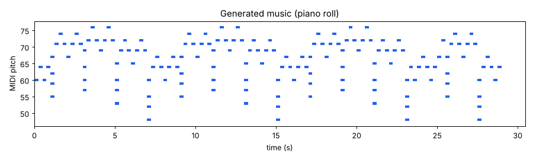

# CodeAlpha Music Generation with AI

An LSTM neural network that learns from MIDI files and composes new music.

## How it works
1. **Data:** MIDI files are read with `pretty_midi`. Each note (or chord, when notes start together) becomes a token such as `60.64.67_4` (pitches + duration in 16th notes). Rests are tokens too.
2. **Model:** an **LSTM** (Embedding -> 2-layer LSTM -> Linear) written in PyTorch learns to predict the next token from the previous 32 (`model.py`, `train.py`).
3. **Generation:** starting from a short seed taken from the training data, the model predicts one token at a time, sampling with a `temperature` that controls how creative it is (`generate.py`).
4. **Output:** the generated tokens are written back to a `.mid` file you can play in any MIDI player.

## Technologies
Python, PyTorch, pretty_midi, NumPy, Matplotlib

## Installation
```bash
git clone https://github.com/shimaa-mansour/codealpha_tasks.git
cd codealpha_tasks/MusicGeneration
pip install -r requirements.txt
```

## Usage
```bash
python make_sample_data.py        # creates 60 small sample MIDI files in data/ (skip if you have your own)
python train.py                   # trains the LSTM (saves model.pt and vocab.json)
python generate.py                # writes generated.mid
python generate.py --length 200 --temperature 1.1 --out my_song.mid
```

### Using your own music
Put any `.mid` files (for example classical piano pieces) inside the `data/` folder and run `train.py` again. More and richer data gives more interesting music. Training is fast on CPU for small datasets.

| Option (generate.py) | Description |
|---|---|
| `--length` | number of notes/chords to generate |
| `--temperature` | lower = safer and more repetitive, higher = more random |
| `--tempo` | playback tempo in BPM |
| `--out` | output MIDI file |

## Example output
`sample_output.mid` was generated by a model trained on the sample data, and `piano_roll.png` shows it.



## Project structure
```
make_sample_data.py   # builds a small demo dataset
preprocess.py         # MIDI <-> token conversion
model.py              # LSTM model
train.py              # training loop (saves the best model by validation loss)
generate.py           # music generation
```

## Limitations
Tokens are played one after another, so long sustained notes under a melody are shortened. The sample data is simple (arpeggios over chord progressions); training on real pieces is needed for more musical results.

## Author
Shimaa Mansour
